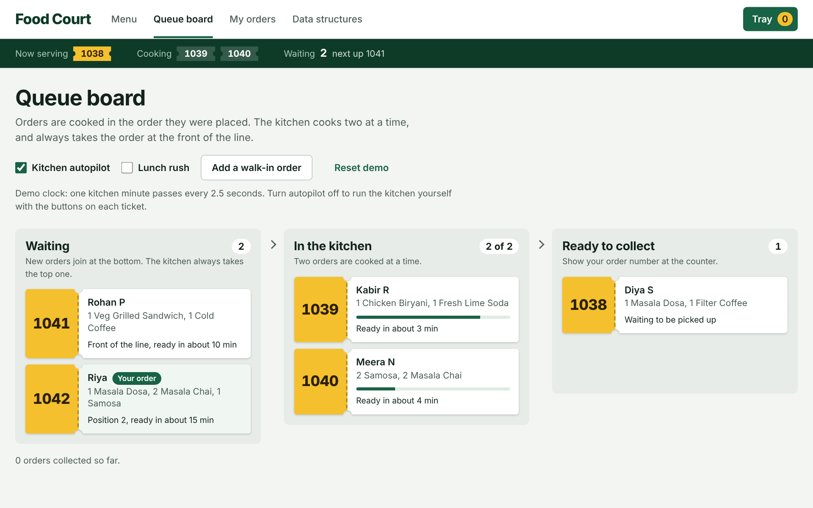
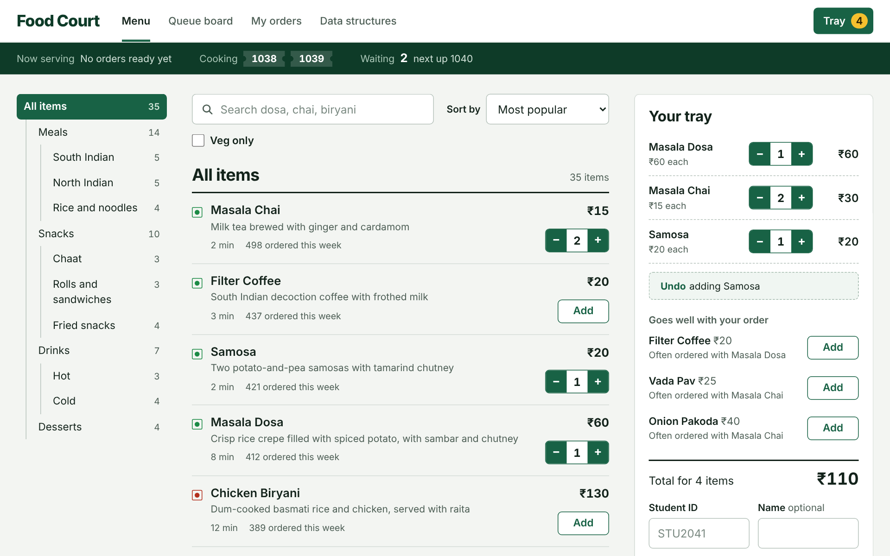
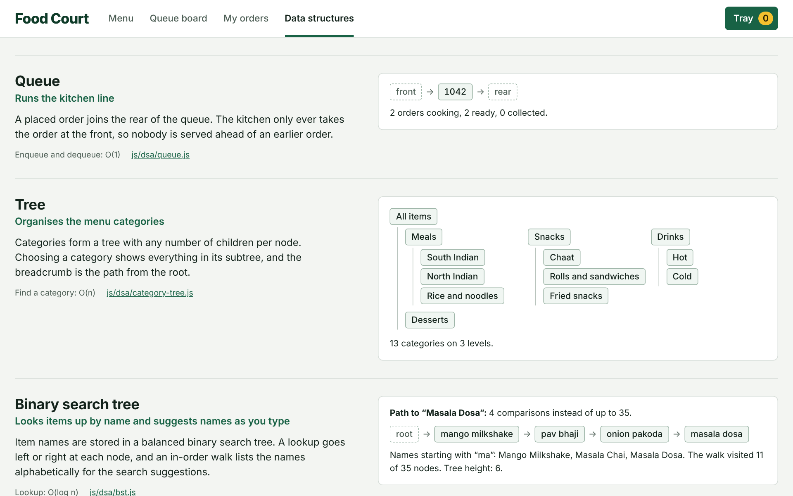

# Smart Food Court Ordering & Queue System

A college food-court website where students browse the menu, place an order and follow their token through the kitchen queue. It is a data structures and algorithms project: every feature runs on a data structure written by hand, with no libraries and no build step.

**Live site:** <https://shivam-pandyacoder24.github.io/Smart-Food-Court-Ordering-Queue-System/>



## What you can do

- **Browse the menu.** Pick a category from the tree, search by word, sort by price, popularity or name, and filter to vegetarian dishes.
- **Fill a tray.** Add and remove dishes, undo your last change, and see suggestions that go well with what you picked.
- **Place an order.** Enter a student ID and get an order number, such as `1042`.
- **Follow the queue.** The queue board shows every order moving from *Waiting* to *In the kitchen* to *Ready to collect*.
- **Track and review.** Look up one order by its number, or see a student's full order history.
- **See how it works.** The *Data structures* page shows what each structure holds right now, and updates as you order.



## How an order moves

```text
Order placed  ->  Queue  ->  Kitchen  ->  Ready  ->  Collected
```

1. A student places an order and gets number `1042`.
2. The order is stored in a **hash table** under its number, added to the head of the student's **linked list** of past orders, and joins the rear of the kitchen **queue**.
3. The kitchen cooks two orders at a time and always takes the order at the **front** of the queue, so nobody is served ahead of an earlier order.
4. When the student tracks `1042`, the hash table goes straight to one bucket instead of scanning every order.

The queue is not a decoration here. It is what decides who gets their food next.

## Data structures and where they are used

| Topic | Used for | Key operations | Code |
| --- | --- | --- | --- |
| Array | The menu items | Read by index, O(1) | [`js/data/menu.js`](js/data/menu.js) |
| Searching | Linear search for the search box; binary search to fetch an item by id | O(n) and O(log n) | [`js/dsa/search.js`](js/dsa/search.js) |
| Sorting | Merge sort for price and popularity; quick sort for names | O(n log n) | [`js/dsa/sort.js`](js/dsa/sort.js) |
| Linked list | Each student's order history, newest first | Add at head, O(1) | [`js/dsa/linked-list.js`](js/dsa/linked-list.js) |
| Stack | Undo for the tray | Push and pop, O(1) | [`js/dsa/stack.js`](js/dsa/stack.js) |
| Queue | The kitchen's line of waiting orders | Enqueue and dequeue, O(1) | [`js/dsa/queue.js`](js/dsa/queue.js) |
| Tree 1: general tree | Menu categories and the breadcrumb | Find, path to root, subtree | [`js/dsa/category-tree.js`](js/dsa/category-tree.js) |
| Tree 2: binary search tree | Item lookup by name and search suggestions | Lookup, O(log n); prefix walk | [`js/dsa/bst.js`](js/dsa/bst.js) |
| Graph | "Goes well with" suggestions between dishes | Neighbours, breadth-first search | [`js/dsa/graph.js`](js/dsa/graph.js) |
| Hashing | Order lookup by order number, student lookup by ID | Insert and lookup, O(1) average | [`js/dsa/hash-table.js`](js/dsa/hash-table.js) |

A few choices worth knowing about:

- **Merge sort for prices, quick sort for names.** Many dishes share a price, and merge sort is stable, so ties keep their menu order. Names are unique, so stability does not matter there.
- **The binary search tree is built balanced.** Names are sorted first and the middle name is inserted first, which gives 35 names a height of 6 instead of 35.
- **The hash table uses separate chaining.** Keys are hashed with a polynomial rolling hash, colliding keys are chained in one bucket, and the table doubles when its load factor passes 0.75.
- **The graph is weighted.** An edge's weight is how often two dishes are ordered together, and suggestions add up the weights from everything in the tray.



## Project structure

```text
index.html              The page and the order the scripts load in
css/styles.css          All styling
js/
  dsa/                  The data structures and algorithms, one per file
  data/menu.js          Sample menu, categories, pairings and students
  app/food-court.js     The food court logic: menu, tray, orders, kitchen queue
  ui/                   One file per page, plus small DOM helpers
tests/                  Tests for every structure and for the ordering flow
```

`js/app/food-court.js` contains no HTML. It only connects the data structures to what a food court does, which is why the same code runs in the browser and in the tests.

## Run it

Open `index.html` in a browser. Nothing needs installing.

To serve it from a local web server instead:

```sh
python3 -m http.server 8000
```

Then visit <http://localhost:8000>.

## Run the tests

The tests need [Node.js](https://nodejs.org) 20 or newer and nothing else.

```sh
npm test
```

They cover each data structure on its own and the full flow: search, sort, undo, placing order `1042`, first-in-first-out cooking, order history and restoring saved orders.

## Good to know

- The orders are a simulation. There is no server; orders are saved in your browser's local storage and stay on your device.
- The site opens with four sample orders, so the first order you place is `1042`.
- The kitchen clock is sped up: one kitchen minute passes every 2.5 seconds. On the queue board, turn off *Kitchen autopilot* to run the kitchen yourself, or turn on *Lunch rush* to have other students keep ordering.

## Built with

HTML, CSS and plain JavaScript.

## Author

Shivam A Pandya ([@shivam-pandyacoder24](https://github.com/shivam-pandyacoder24))

## Licence

[MIT](LICENSE)
